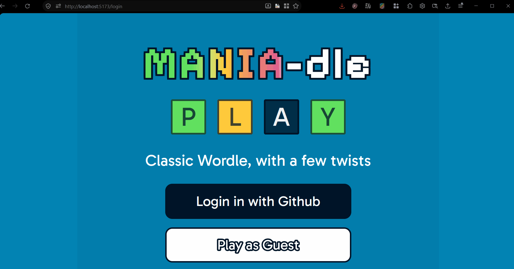

# Mania-dle

CodePath WEB103 Final Project

Designed and developed by: Christian Gomez Diaz, Phillipe Manio, Evelyn Rodriguez, Jay Wageni, Vanessa Tang

🔗 Link to deployed app: N/A

## About

A Web Application based on the hit sudoku-type word game “Wordle”.

### Description and Purpose

Wordle is a daily brainteaser puzzle which has taken over the world. Started during the pandemic, Wordle has inspired a cottage industry of small sudoku-like web games. However, Wordle Mania isn’t like any other “-dle”-type game! We have unique features and game modes that make our project unique!

### Inspiration

Obvious inspiration came from NYT’s Wordle, however our unique gamemodes are inspired by Mario Party (due to its collaborative yet competitive game structure), Uno Party (due to the additional, frenzied twists added to the card game) and competitive speedrunning (due to the timed competitive nature that speedrunning creates).

## Tech Stack

Frontend:
- React
- Javascript

Backend:
- Node.js
- Express.js
- Render (PostgreSQL Database)
- Passport.js (User Account Authorization) 

## Features
### User Authentication

Users can login and out of the app using their GitHub account. If times permits, more SSO will be implemented.

 
### Classic Wordle

The original game of Wordle. A player tries to find an n-letter word (n being a positive integer) by trial and error. Each guess gives the player clues (what letters are in the word, the correct position of each valid letter, etc). Using these clues, they have to solve the puzzle in (n+1) rounds.

### Custom Wordle Creator

Users can create their own Wordle with custom words to share with other players. The user has the option to update or delete the Wordle after it is created.

### Player Profiles

Players can create an account to track their stats including total games played, which Wordles they have solved so far, and all the custom Wordles they have created. They can also personalize their profile to showcase their favorite word and their favorite Wordle mode.

### Leaderboard

Ranks players by stats like fastest solve time and total Wordles solved. Each custom Wordle also has its own leaderboard, so players can see who it solved it the fastest. There are leaderboards for other Wordle modes as well.

[gif goes here]

### Clock Mode

A timed version of Wordle. A stopwatch starts on your first letter and times how fast you solve the puzzle.

### Browse Custom Wordles

Players can see a list of recently made custom Wordles and pick one to play. They can sort the list by newest or most played.

### [ADDITIONAL FEATURES]

### Switcharoo Mode

Classic Wordle with a twist. At some point during the game, the answer shuffles into an anagram of itself (for example, EARTH becomes HEART). The screen shows "Switcharoo!" when it happens. The game still has a total of 6 rounds.

### Hint Button

Players who get stuck can reveal one correct letter, but it costs them a guess.

[gif goes here]

## Installation Instructions

[instructions go here]

