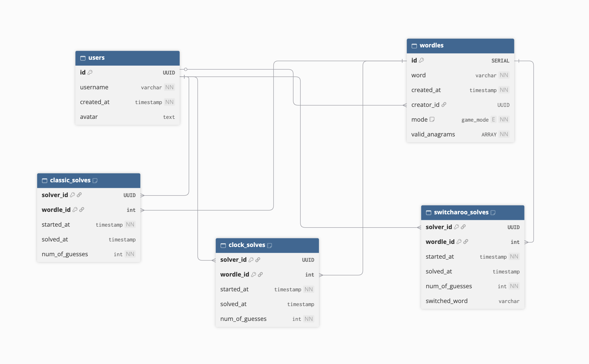

# Entity Relationship Diagram

## Diagram

[dbdiagram](https://dbdiagram.io/d/Mania-dle-Entity-Relationship-Diagram-6ad953eef65bbc60f6f9923b)

## Tables

### USERS

**Description:** Stores all basic user information. Data about a user's leaderboard or game stats will be fetched via aggregation queries or computed server-side instead of being stored within the table.

| Field      | Type         | Constraints                   | Description                                                                                               |
| ---------- | ------------ | ----------------------------- | --------------------------------------------------------------------------------------------------------- |
| id         | UUID         | Primary Key,  NOT NULL    | User id auto-generated by PostgreSQL using `gen_random_uuid()` on insertion                               |
| username   | varchar(255) | NOT NULL                      | A user's username; defaulted to the username fetched from SSO, but can be changed by the user             |
| created_at | timestamp    | NOT NULL,   DEFAULT NOW() | Datetime of when the user object was created and inserted into the database                               |
| avatar     | text         | NULL                          | A user's profile picture; fetched from authentication details when the user uses SSO to log in to the app |

### WORDLES

**Description:** Stores information about a wordle game. Wordles can be created to only work in a specific game mode or can be defaulted to work on any game mode. Users can create a custom wordle, but not all wordles are custom.

| Field          | Type                                                     | Constraints                  | Description                                                                                                                                                                   |
| -------------- | -------------------------------------------------------- | ---------------------------- | ----------------------------------------------------------------------------------------------------------------------------------------------------------------------------- |
| id             | serial                                                   | Primary Key,  NOT NULL   | A Wordle's unique number id that is auto-generated by PostgreSQL on insertion                                                                                                 |
| word           | varchar(255)                                             | NOT NULL                     | The solution to the wordle                                                                                                                                                    |
| created_at     | timestamp                                                | NOT NULL,  DEFAULT NOW() | Datetime of when the wordle object was created and inserted into the database                                                                                                 |
| creator_id     | UUID                                                     | Foreign Key,  NULL       | User id of the user that created the wordle. This field only exists if the Wordle is customly created. All Wordles that are generated by default, will not have a creator id. |
| mode           | ENUM game_mode (`all`, `classic`, `clock`, `switcharoo`) | NOT NULL,  DEFAULT `all` | Game mode of the wordle; if `all`, game can be played in any of the modes                                                                                                     |
| valid_anagrams | array(varchar(255)                                       | NOT NULL                     | An array of anagrams that can be used for Switcheroo mode. This is computed on the server side before insertion.                                                              |

### CLASSIC_SOLVES

**Description:** Stores all Classic mode solves, this includes games that are won and games that are lost.

| Field          | Type      | Constraints                                  | Description                                                                   |
| -------------- | --------- | -------------------------------------------- | ----------------------------------------------------------------------------- |
| solver_id      | UUID      | Primary Key,  Foreign Key,  NOT NULL | User id of the user that solved the wordle                                    |
| wordle_id      | int       | Primary Key,  Foreign Key,  NOT NULL | The id of the associated wordle                                               |
| started_at     | timestamp | NOT NULL                                     | Datetime of when the user started the wordle; used for tracking streaks       |
| solved_at      | timestamp | NULL                                         | Datetime of when the user solved the wordle; marked as `NULL` if game is lost |
| num_of_guesses | int       | NOT NULL                                     | The number of guesses it took the user to solve the wordle                    |

### CLOCK_SOLVES

**Description:** Stores all Clock mode solves, this includes games that are won and games that are lost. The completion time is computed on server side instead of being stored in the table.

| Field          | Type      | Constraints                                  | Description                                                                                                                                                                                                      |
| -------------- | --------- | -------------------------------------------- | ---------------------------------------------------------------------------------------------------------------------------------------------------------------------------------------------------------------- |
| solver_id      | UUID      | Primary Key,  Foreign Key,  NOT NULL | User id of the user that solved the wordle                                                                                                                                                                       |
| wordle_id      | int       | Primary Key,  Foreign Key,  NOT NULL | The id of the associated wordle                                                                                                                                                                                  |
| started_at     | timestamp | NOT NULL                                     | Datetime of when the user started the wordle; used for tracking streaks; the total time it took the user to solve the wordle is computed on server side using the `solved_at` field and `started_at` field       |
| solved_at      | timestamp | NULL                                         | Datetime of when the user solved the wordle; marked as `NULL` if game is lost; the total time it took the user to solve the wordle is computed on server side using the `solved_at` field and `started_at` field |
| num_of_guesses | int       | NOT NULL                                     | The number of guesses it took the user to solve the wordle                                                                                                                                                       |

### SWITCHAROO_SOLVES

**Description:** Stores all Switcharoo mode solves, this includes games that are won and games that are lost. The switched word is stored if the word ends up switching mid-game. If the user solves the wordle before the switch, this field is kept as empty.

| Field          | Type         | Constraints                                  | Description                                                                                                                                        |
| -------------- | ------------ | -------------------------------------------- | -------------------------------------------------------------------------------------------------------------------------------------------------- |
| solver_id      | UUID         | Primary Key,  Foreign Key,  NOT NULL | User id of the user that solved the wordle                                                                                                         |
| wordle_id      | int          | Primary Key,  Foreign Key,  NOT NULL | The id of the associated wordle                                                                                                                    |
| started_at     | timestamp    | NOT NULL                                     | Datetime of when the user started the wordle; used for tracking streaks                                                                            |
| solved_at      | timestamp    | NULL                                         | Datetime of when the user solved the wordle; marked as `NULL` if game is lost                                                                      |
| num_of_guesses | int          | NOT NULL                                     | The number of guesses it took the user to solve the wordle                                                                                         |
| switched_word  | varchar(255) | NULL                                         | The anagram that the solution was switched to during the game. This is set to `NULL` if the user solves the wordle before Switcharoo is activated. |

## Database Relationships

| From | To     | Via Column/Table   | Relationship Type  | Description                                                                                                                                                                                         |
| ---- | ------ | ------------------ | ------------------ | --------------------------------------------------------------------------------------------------------------------------------------------------------------------------------------------------- |
| user | wordle | wordles.creator_id | One-to-Many (1:N)  | A user can create many custom wordles. Wordles that are inserted by default do not have a creator.                                                                                                  |
| user | wordle | classic_solves     | Many-to-Many (M:N) | Tracks classic mode solves. A user can solve many classic mode wordles. A wordle can be solved in classic mode by many users. Therefore many users can solve many classic mode wordles.             |
| user | wordle | clock_solves       | Many-to-Many (M:N) | Tracks clock mode solves. A user can solve many clock mode wordles. A wordle can be solved in clock mode by many users. Therefore many users can solve many clock mode wordles.                     |
| user | wordle | switcharoo_solves  | Many-to-Many (M:N) | Tracks switcharoo mode solves. A user can solve many switcharoo mode wordles. A wordle can be solved in switcharoo mode by many users. Therefore many users can solve many switcharoo mode wordles. |
