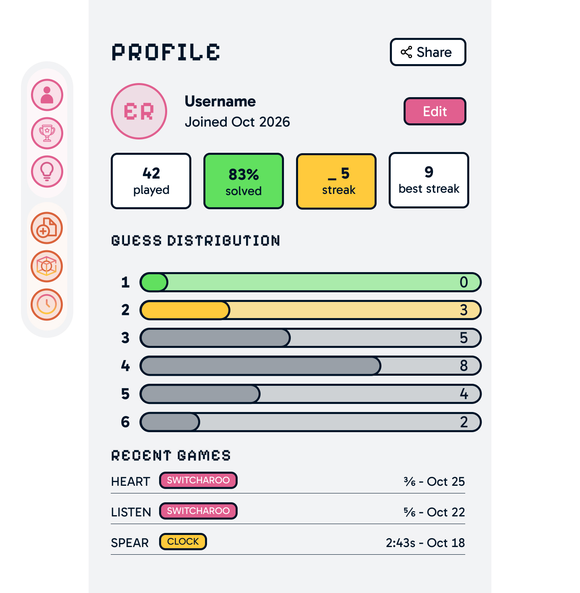

# Wireframes

Reference the Creating an Entity Relationship Diagram final project guide in the course portal for more information about how to complete this deliverable.

## List of Pages

- Landing Page 
- ⭐Home Page (Post User Authenticated)
- ⭐Profile Page (User Information)
- Puzzle Creation Page
- Browser 
- Leaderboard
- Classic Puzzle Page
- Clock Puzzle Page
- ⭐Switcharoo Puzzle Page

## Wireframe 1: [Switcharoo Puzzle Page]

## Wireframe 2: [Home Page]

## Wireframe 3: [Profile Page]

